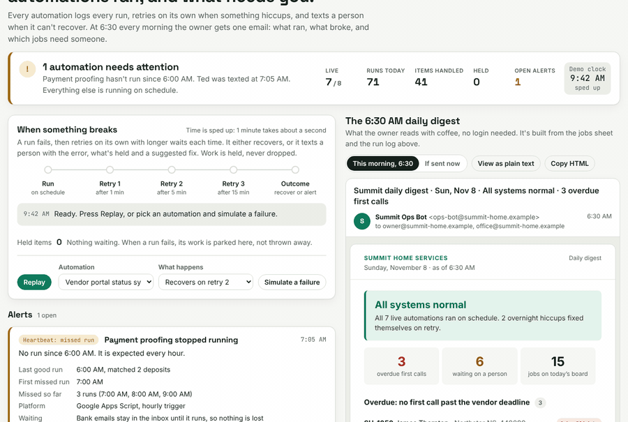
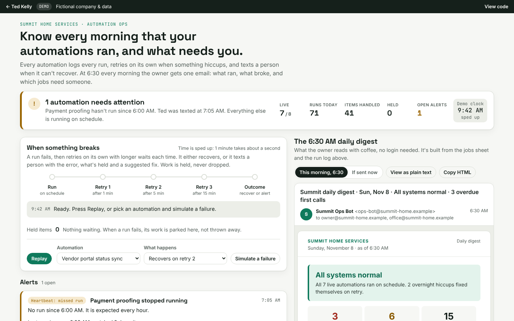

# Daily Digest: health checks for your automations

Know every morning that your automations ran, and what needs you.

**Try it:** https://tedkelly.dev/projects/daily-digest/



## The problem

Things break and nobody notices.

A small service business might have six or eight automations: one turns emails into tickets, one texts techs about first-call deadlines, one keeps the warranty portals up to date, one marks jobs paid when the money arrives. They work, until one day one of them doesn't. A warranty portal goes down. Google changes a permission. Someone moves a spreadsheet. The automation stops, and nothing tells you. Three days later a warranty company asks why claims haven't been updated, or a customer asks why nobody called.

## What it does

- **Logs every run** of every automation, including the boring "nothing new" runs, with the result, item count, duration and, when something fails, the error in plain English ("Vendor portal returned 503").
- **Retries on its own** with growing waits (1 minute, then 5, then 15). Most hiccups fix themselves, and they're logged quietly with no one woken up.
- **Fails to a person.** When the retries run out, Ted gets a text and the office gets an email. Each one says what broke, when, how many items are waiting, and a suggested fix.
- **Holds the work.** Items from a failed run are parked and re-processed on the next good run. Nothing is dropped.
- **Checks the heartbeat.** A separate watchdog checks that each automation actually ran when it should have. An automation that stops quietly, without any error, is flagged within 5 minutes ("Payment proofing: no run since 6:00 AM, expected every hour").
- **Sends a daily digest at 6:30 AM.** It's one email showing whether everything is healthy, which jobs are past their first-call deadline, what's waiting on a person, who's working today, and yesterday in numbers.

The demo plays a failure as soon as it loads. Press **Replay** to watch it again, or pick any automation and choose **Retries run out** to see the alert, the text message and the email. Then press **Mark fixed** to watch the held items get re-processed. **If sent now** shows the digest the owner would get with everything that has happened so far.

## Before and after

| Before | After |
|---|---|
| An automation stops and nobody knows until a customer or vendor complains. | The watchdog flags a missed run within 5 minutes and texts a person. |
| A temporary error loses the emails, payments or updates it was handling. | Failed items are held and re-processed. The log shows exactly what happened. |
| The owner logs into three tools to find out if things are working, or just doesn't. | A 6:30 AM email answers "is everything OK, and what needs me today?" |
| A new automation goes live untested and sends wrong texts to real customers. | New automations start in shadow mode: they log what they would have done, and nothing is sent until someone has checked. |
| Overdue first calls get found when the warranty company complains. | They're at the top of the digest every morning, with how late each one is. |

## The safety rules it follows

1. **Every automation logs every run.** If it isn't in the log, it didn't happen.
2. **Retries with backoff.** It waits 1, 5, then 15 minutes, so a short outage fixes itself without anyone being bothered.
3. **Fail to a person, with full context.** The alert gives the error in plain English, when it started, what's held and a suggested fix, by text and email. You get one alert per problem, not one every 15 minutes.
4. **Heartbeat checks catch silent stops.** The watchdog runs on a different platform from the automations it watches, and the watchdog is checked too.
5. **Shadow mode for new automations.** A new automation runs for real but only logs what it would have done, until someone has checked it.
6. **Nothing dropped silently.** Failed work is held and re-processed, and the held count is visible.
7. **A daily digest,** so the owner sees the health of everything without logging in. The digest has a heartbeat too: if it hasn't arrived by 7:00 AM, Ted gets a text.

## What it costs to run

- **Google Apps Script version** (`apps-script/daily-digest.gs`): free within a Google Workspace or Gmail account, within Google's daily email and run-time quotas. That's plenty for one digest a day and a health check every 15 minutes.
- **n8n version** (`n8n/m2-health-check.json`): either self-hosted on a small server (a basic cloud VPS costs a few dollars a month), or n8n Cloud on a monthly plan. Pricing changes, so check n8n's current pricing page.
- **Alerts:** email is free. Text alerts go through an SMS provider and cost a few cents each, and you should only get a handful a month.

Ted's monthly retainer covers watching these alerts, fixing what breaks and improving the automations over time.

## For developers

- `index.html`, `app.css`: the console page (shared tokens come from `shared/demo.css`).
- `ops.js`: the engine (`window.Ops`). It holds the automations, the simulated run log, status, heartbeat checks and the digest builder (`buildDigest(state, asOf)` returns `{ subject, html, text }`). It has no DOM code, so you can test it in Node:

  ```js
  global.window = global;
  require('shared/data.js');
  const Ops = require('./ops.js');
  const st = Ops.createState();
  console.log(Ops.buildDigest(st, Ops.DIGEST_AT).text);
  ```
- `app.js`: the UI and the failure → retry → alert scenario. Add `?autoplay=0` to the URL to skip the scenario that plays on load.
- `apps-script/daily-digest.gs`: a working Apps Script. It reads the Jobs, Automation Log and Automations sheets, works out overdue first calls and automation health, and sends the digest with `MailApp` from a time-driven trigger. It has a `SHADOW_MODE` property, and a try/catch that emails a failure alert to a person.
- `n8n/`: an importable n8n workflow plus a [README](n8n/README.md).

Everything in the demo runs in your browser. The only thing saved (in `localStorage`, wrapped in try/catch) is which digest view and log filter you picked.



## Built with

Plain HTML, CSS and JavaScript, with no framework and no build step. It's hosted on GitHub Pages. The production versions use Google Apps Script or n8n with Google Sheets.

## Note

Summit Home Services, its techs, customers, warranty companies, suppliers and claim numbers are fictional. Every run, error and number in this demo is simulated.

## Run it locally

No install or build step. Clone the repo and open `index.html` in a browser, or serve the folder:

```bash
git clone https://github.com/TedKelly561/daily-digest.git
cd daily-digest
python3 -m http.server 8000   # then open http://localhost:8000
```

`shared/data.js` holds the fictional company (Summit Home Services) shared by every demo in the toolkit. The Apps Script version is in [`apps-script/`](apps-script/) and the n8n workflow in [`n8n/`](n8n/).

## More from Ted Kelly

- [Work Order Intake (M1)](https://github.com/TedKelly561/work-order-intake): messy email → checked service ticket
- [Quote Builder](https://github.com/TedKelly561/quote-builder): price-book quotes with margin view and approve links
- [Dispatch Board](https://github.com/TedKelly561/dispatch-board): drag-and-drop dispatch with first-call deadline alerts
- [Owner's KPI Dashboard](https://github.com/TedKelly561/kpi-dashboard): the numbers that run a service business

## About

Built by **Ted Kelly**: I build automations for field service, repair and warranty businesses, switch them on safely, and keep them running. See the [safety method](https://tedkelly.dev/safety/) or book a free 20-minute call at **[tedkelly.dev](https://tedkelly.dev)**.

## License

[MIT](LICENSE). All companies, people, addresses and claim numbers in this demo are fictional.
